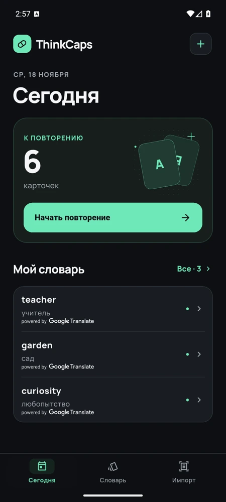
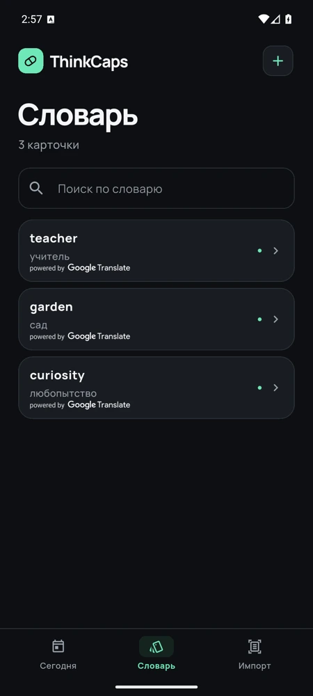
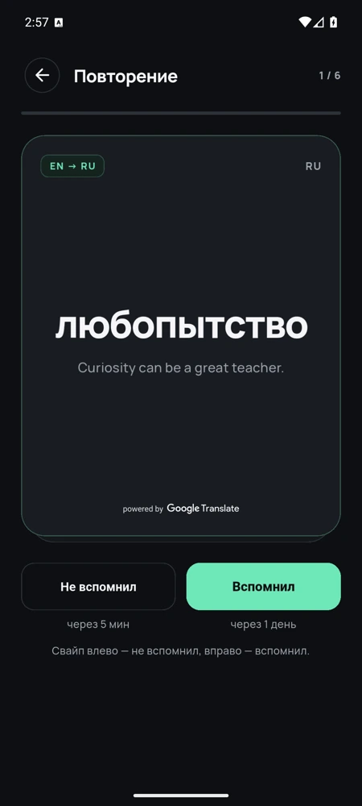

# ThinkCaps

ThinkCaps — Android-приложение для пополнения словаря и повторения английских слов с русским переводом.

## Скриншоты

| Сегодня | Словарь | Повторение | Импорт скриншота |
| --- | --- | --- | --- |
|  |  |  |  |

## Установка

Скачайте APK со страницы [релизов](https://github.com/Linsaym/ThinkCaps/releases) и откройте его на устройстве с Android 7.0 или новее.

- На вкладке **Сегодня** добавьте слово или начните повторение. Коснитесь английского слова, чтобы услышать произношение. Коснитесь любого другого места карточки, в том числе русского слова, чтобы открыть перевод. Затем свайпните вправо, если вспомнили, или влево, если забыли.
- Откройте **Быстрое добавление** кнопкой «Добавить карточку». Введите английское слово, устойчивое выражение или фразовый глагол. Первый вариант перевода уже выбран. Можно заменить его и выбрать один пример. После сохранения сразу вводите следующий термин в том же поле.
- Попробуйте назвать ответ до переворота. Если не вспомнили, карточка вернётся через пять минут в этой или следующей сессии. Между показами двух направлений одной пары проходит короткая пауза. Пока ждёте, можно повторять другие слова или вернуться позже.
- Во вкладке **Словарь** можно найти карточку по слову или переводу, исправить перевод и добавить контекст.
- Во вкладке **Импорт** выберите скриншот из памяти телефона или вставьте текст. Текст со скриншота отображается и сохраняется в нижнем регистре. Можно также отправить выделенный текст из другого приложения через Android «Поделиться» → ThinkCaps.
- Коснитесь слова в импортированном предложении, чтобы открыть перевод и сохранить это предложение в карточке.

## Как работает приложение

Интервалы повторения рассчитываются для каждого направления отдельно. Первый успешный ответ откладывает карточку на день, второй — на три дня. Дальше интервал увеличивается до 180 дней. После ошибки карточка снова доступна через пять минут.

Карточки, контекст и расписание хранятся в локальной SQLite. Распознавание латиницы работает на устройстве. Автоперевод использует Google Translate через [ML Kit](https://developers.google.com/ml-kit/language/translation/android). Первому автопереводу требуется интернет для скачивания языковой модели. После загрузки перевод работает офлайн. Перевод можно отредактировать вручную. [Требования к атрибуции Google Translate](https://cloud.google.com/translate/attribution)

В быстром добавлении введённый термин отправляется в [Kaikki.org](https://kaikki.org/dictionary/English/) и [Tatoeba](https://tatoeba.org). Варианты перевода и часть примеров извлечены из [Английского Викисловаря](https://en.wiktionary.org/) через Wiktextract и отобраны в ThinkCaps. Данные Викисловаря распространяются по [CC BY-SA 4.0](https://creativecommons.org/licenses/by-sa/4.0/), примеры из Tatoeba — по [CC BY 2.0 FR](https://creativecommons.org/licenses/by/2.0/fr/) или CC0 1.0. Если словарного перевода нет, доступен автоперевод ML Kit или ручной ввод.

Для озвучки используется выбранный в Android движок синтеза речи. Установленный английский офлайн-голос работает без интернета. [Android TextToSpeech](https://developer.android.com/reference/android/speech/tts/TextToSpeech)

Интерфейс и планировщик написаны на Dart. Мост к SQLite, ML Kit и системному импорту реализован в Kotlin через Flutter MethodChannel. Шрифт Manrope поставляется по [SIL Open Font License](assets/fonts/OFL.txt).

Автоматические переводы предоставляются как есть. Google не гарантирует их точность, надёжность, товарную пригодность, соответствие конкретной цели или отсутствие нарушений прав третьих лиц.

## Сборка

Версия Flutter закреплена в [`.flutter-version`](.flutter-version). Настройка среды, команды проверки, карта кода и релизная сборка описаны в [руководстве по разработке](docs/development.md). Codex начинает с [`AGENTS.md`](AGENTS.md).

```powershell
powershell -NoProfile -File tool/check.ps1
```

Для Linux и macOS используйте `pwsh` вместо `powershell`.
