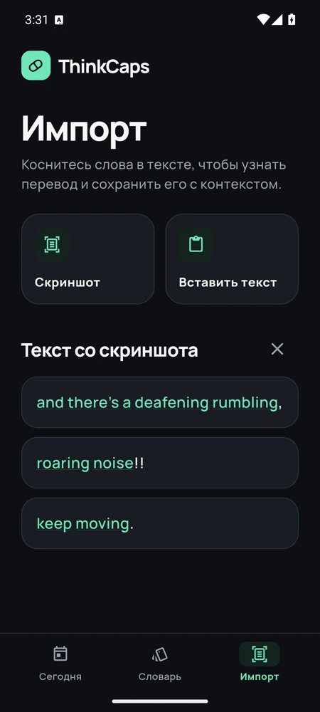

# ThinkCaps

ThinkCaps — Android-приложение для пополнения словаря и повторения английских слов с русским переводом.

## Скриншоты

| Сегодня | Словарь | Повторение | Импорт скриншота |
| --- | --- | --- | --- |
|  |  |  |  |

## Установка

Скачайте APK со страницы [релизов](https://github.com/Linsaym/ThinkCaps/releases) и откройте его на устройстве с Android 7.0 или новее.

- На вкладке **Сегодня** добавьте слово или начните повторение. Коснитесь карточки, чтобы увидеть ответ, затем свайпните вправо, если вспомнили, или влево, если забыли.
- Во вкладке **Словарь** можно найти карточку по слову или переводу, исправить перевод и добавить контекст.
- Во вкладке **Импорт** выберите скриншот из памяти телефона или вставьте текст. Текст со скриншота отображается и сохраняется в нижнем регистре. Можно также отправить выделенный текст из другого приложения через Android «Поделиться» → ThinkCaps.
- Коснитесь слова в импортированном предложении, чтобы открыть перевод и сохранить это предложение в карточке.

## Как работает приложение

Интервалы повторения рассчитываются для каждого направления отдельно. Первый успешный ответ откладывает карточку на день, второй — на три дня. Дальше интервал увеличивается до 180 дней. После ошибки карточка снова доступна через пять минут.

Карточки, контекст и расписание хранятся в локальной SQLite. Распознавание латиницы работает на устройстве. Автоперевод использует Google Translate через [ML Kit](https://developers.google.com/ml-kit/language/translation/android). Первому автопереводу требуется интернет для скачивания языковой модели. После загрузки перевод работает офлайн. Перевод можно отредактировать вручную. [Требования к атрибуции Google Translate](https://cloud.google.com/translate/attribution)

Интерфейс и планировщик написаны на Dart. Мост к SQLite, ML Kit и системному импорту реализован в Kotlin через Flutter MethodChannel. Шрифт Manrope поставляется по [SIL Open Font License](assets/fonts/OFL.txt).

Автоматические переводы предоставляются как есть. Google не гарантирует их точность, надёжность, товарную пригодность, соответствие конкретной цели или отсутствие нарушений прав третьих лиц.

## Сборка

Инструменты проекта — Flutter 3.41.9, Dart 3.11.5, JDK 17+, Android SDK 36, NDK 28.2.13676358 и CMake 3.22.1.

```sh
flutter pub get
flutter analyze
flutter test
flutter run
```

Для релизной подписи задайте переменную окружения `THINKCAPS_KEY_PROPERTIES` с абсолютным путём к файлу свойств Java. В нём нужны свойства `storeFile`, `storePassword`, `keyAlias` и `keyPassword`. Используйте абсолютный путь к хранилищу ключей. Для обновлений устанавливаемого APK используйте один и тот же ключ.

```sh
flutter build apk --release
```

APK появляется в `build/app/outputs/flutter-apk/app-release.apk`.
